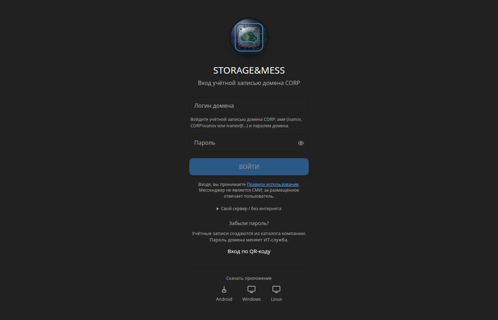
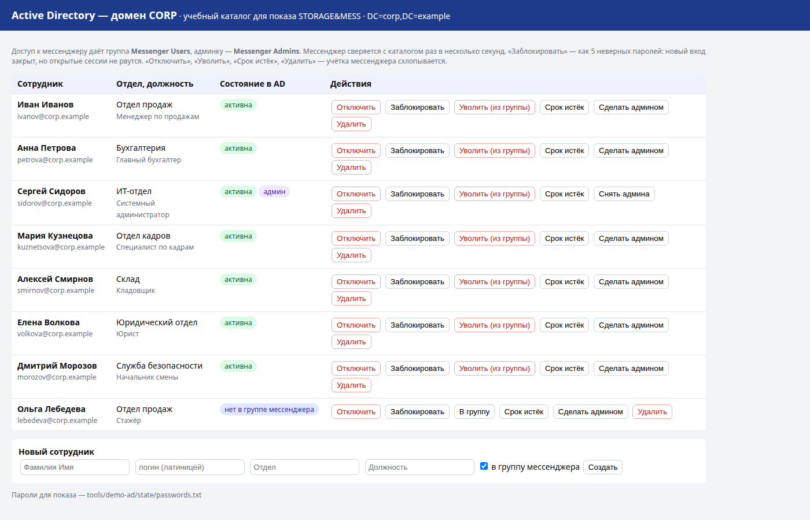
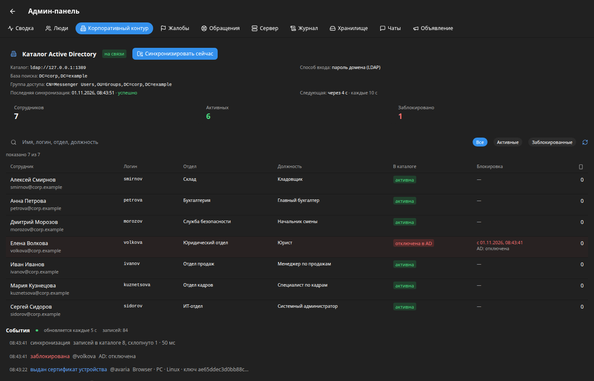
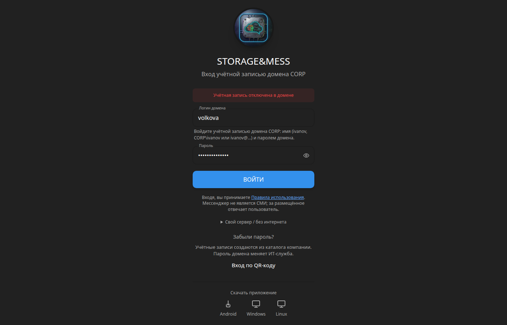

# STORAGE&MESS Enterprise — корпоративный контур

Мессенджер, который ставится **у заказчика** и живёт по правилам его каталога:
сотрудник появился в Active Directory — у него появилась учётка; отключили,
уволили, истёк срок — учётка мессенджера «схлопывается» сама, со всех
устройств, за секунды. Своих паролей у мессенджера нет: вход — паролем домена
или через RADIUS.

```
            Active Directory / FreeIPA / Samba (LDAP, LDAPS)
                 │  синхронизация: кто есть, кто в группе, кто отключён
                 ▼
  ┌──────────────────────────────┐        RADIUS (NPS, FreeRADIUS, OTP)
  │  Сервер STORAGE&MESS          │◄────── проверка входа
  │  у заказчика (self-host)      │
  │  • учётки из каталога         │──────► УЦ организации: сертификаты
  │  • схлопывание и отзыв сессий │        устройств, подписанный список
  │  • журнал событий             │        отзыва (CRL)
  └──────────────┬───────────────┘
                 │ веб, Android, Windows/Linux, радиоканал LoRa (шлюз)
                 ▼
            сотрудники организации
```

Два контура, как задумано продуктом:

| | Корпоративный (этот репозиторий) | Пользовательский |
|---|---|---|
| Сервер | у организации, продаётся бизнесу | нет — пользователи сами себе сервер (P2P, mesh, самохост) |
| Учётки | из каталога (AD/LDAP), без регистрации | своя, на устройстве |
| Выход сотрудника | автоматически по каталогу | — |
| Код | открыт для ознакомления, использование по договору | AGPL-3.0: [storage-mess](https://github.com/codercat9-cyber/storage-mess), [smess-lora](https://github.com/codercat9-cyber/smess-lora) |

## Что работает сейчас (демо)

| | |
|---|---|
|  |  |
| **Вход учётной записью домена.** Регистрации нет — учётки создаёт каталог. | **Учебный Active Directory** для показа: отключить, заблокировать, уволить, принять. |
|  |  |
| **Админка: каталог, сотрудники, журнал.** Сотрудницу отключили в AD — через секунды «отключена в AD», событие в журнале. | **Её попытка войти** — отказ с понятной причиной. Открытые сессии уже закрыты. |

- **Учётки из каталога.** Сотрудники из группы доступа (`Messenger Users`) получают учётку сами, с ФИО, отделом, должностью и почтой из AD. Группа админов каталога даёт роль администратора, исключение из неё роль снимает.
- **Схлопывание.** Учётку отключили, истёк срок, сотрудника убрали из группы или удалили из каталога — сервер блокирует её, отзывает все сессии и токены, рвёт открытые соединения (клиент сразу выходит) и отзывает ключи устройств. Включили обратно — учётка вернулась. Ручную блокировку администратора каталог не снимает.
- **Блокировка после неверных паролей — не увольнение.** Lockout запрещает новый вход, но открытые сессии не рвёт. Иначе любой мог бы выкинуть коллегу, перебирая пароль от его имени.
- **Защита от массовой ошибки.** Каталог недоступен или вернул подозрительно мало сотрудников — никто не блокируется, админка показывает ошибку.
- **Вход.** LDAP/LDAPS bind паролем домена, RADIUS (PAP с Message-Authenticator) или оба сразу (`ENT_AUTH=ldap | radius | ldap+radius`). Пустой пароль отсекается: AD считает такой вход «успешным». Логин экранируется против LDAP-инъекций. Принимаются `ivanov`, `CORP\ivanov`, `ivanov@corp.example`.
- **Аварийный локальный администратор** — на случай, когда домен лежит (в `.env` только bcrypt-хеш).
- **УЦ организации.** Устройство после входа получает сертификат на свой ключ (Ed25519). Список отзыва подписан, клиент проверяет подпись и закрепляет ключ УЦ. Сообщения радиоканала, подписанные отозванным ключом, помечаются и не принимаются.
- **Журнал событий:** создание, обновление, блокировка, возврат, входы и отказы (без паролей), выдача и отзыв сертификатов, синхронизации и их ошибки.

Всё это проверяет сквозной тест `tools/demo-ad/e2e.cjs` — 49 проверок, включая атаки: пустой пароль, LDAP-инъекции, старые токены после схлопывания, переподключение сокета, подделанные сертификат и список отзыва, недоступный каталог, чужой секрет RADIUS, пароли в журнале.

## Запустить демо

Нужны Node.js 20+ и Linux или macOS. Всё слушает только `127.0.0.1`.

```bash
tools/demo-ad/start-demo.sh      # сборка, учебный AD, RADIUS, сервер
node tools/demo-ad/e2e.cjs       # сквозная проверка
tools/demo-ad/stop-demo.sh
```

- мессенджер — http://127.0.0.1:9400
- консоль учебного AD — http://127.0.0.1:9480
- пароли для показа — `tools/demo-ad/state/passwords.txt`
- вход через RADIUS — `DEMO_AUTH=radius tools/demo-ad/start-demo.sh`

С настоящим доменом: в `server/.env` — `ENT_DIRECTORY=ldap`, `ENT_LDAP_URL=ldaps://dc1.example.local`, служебная учётка только на чтение (`ENT_LDAP_BIND_DN`, `ENT_LDAP_BIND_PASSWORD`), `ENT_LDAP_BASE_DN`, `ENT_LDAP_GROUP_DN`. Полный список — `server/src/enterprise/config.ts`.

## Честно о пределах

- «Мгновенно» означает «за интервал опроса каталога»: в демо 10 с, в эксплуатации 30–60 с. Если нужно быстрее — DirSync или uSNChanged.
- В режиме только RADIUS (без LDAP) сервер не узнаёт об увольнении: RADIUS отвечает лишь «да/нет» на вход. Поэтому синхронизацию по LDAP нужно держать всегда, а RADIUS использовать как второй фактор.
- Устройство в офлайне узнает об отзыве при следующем выходе на связь. Радиоузлы — при следующем приёме списка отзыва. Сертификаты устройств короткоживущие.
- Сертификации ФСТЭК/ФСБ нет. Для КИИ и госзаказчиков — работа поверх сертифицированного VPN заказчика. Отдельная дорожная карта — в [разборе ТЗ](docs/РАЗБОР-ТЗ.md).

## Дорожная карта

1. Группы AD → чаты и каналы; адресная книга из каталога (фото, телефон, руководитель).
2. Офбординг: передача групп и файлов руководителю, очистка кэша на устройстве при блокировке.
3. Вход через OIDC (Keycloak, ADFS) и Kerberos; SCIM для заказчиков с внешним IdP; профили FreeIPA и ALD Pro.
4. Архив переписки по политике организации — открыто для сотрудников, с журналом «кто читал».
5. Корпоративный радиоканал: сертификат УЦ в кадре «представиться», подписанные дельта-списки отзыва через шлюз LoRa.

## Лицензия

Код этого репозитория открыт **для ознакомления**. Использование, развёртывание и
изменение — по договору с правообладателем, см. [LICENSE.md](LICENSE.md). Открытое
ядро мессенджера (без корпоративных модулей) — AGPL-3.0, см. `LICENSE-AGPL-3.0.txt`.
Закрытая защита радиоканала в этом репозитории заменена заглушкой с тем же интерфейсом.
